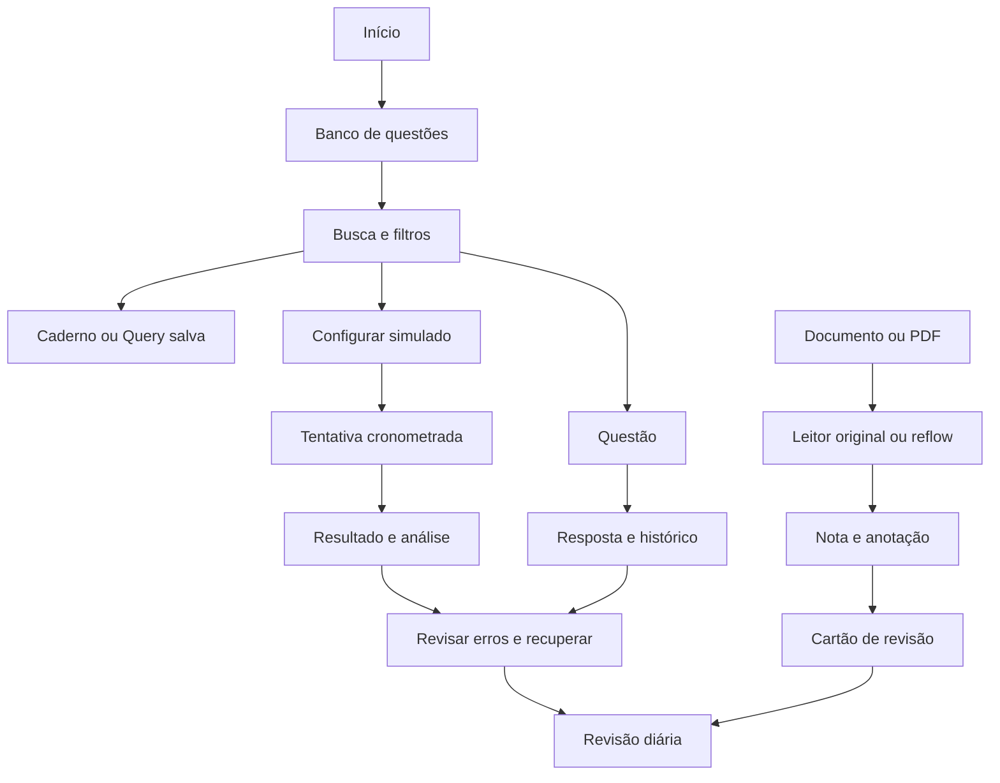

# 03 — Fluxos de estudo

> As setas representam o fluxo de produto modelado. Consulte as fontes para distinguir implementação, parcialidade e pendências.

## Invariantes

- A mesma questão é reutilizada em prática, caderno, simulado e revisão.
- Filtros preservam critérios e exclusões ao salvar query ou gerar caderno/simulado.
- Resposta avulsa não depende de simulado.
- Revisão revela a resposta sob demanda e registra o agendamento.
- Leitor PDF preserva posição, busca, notas e marcações.

## Documentos

- [Estratégia de questões — #230](../../pesquisas/230-estrategia-questoes/README.md)
- [Pesquisa QConcursos — #31](../../research/qconcursos-issue-31-2026-11-15.md)
- [Inventário ExamTopics](../../research/examtopics-inventory.md)
- [Gran Questões — #62](../../research/gran-questoes-issue-62-2026-11-15.md)
- [Análise QConcursos](../../../prototypes/analises/analise-qconcursos.md)
- [Análise ExamTopics](../../../prototypes/analises/analise-examtopics.md)
- [Dossiê Readwise Reader e SRS](../../../prototypes/board-exam-app/READWISE_DOSSIER.md)

## Blocos originais

- [e508 — Navegação, grade e relatório](../../../prototypes/board-exam-app/index.html#e508)
- [e1155 — Questões e simulados](../../../prototypes/board-exam-app/index.html#e1155)
- [e1177 — Diagnóstico PDF.js](../../../prototypes/board-exam-app/index.html#e1177)
- [e1188 — Cadernos e queries](../../../prototypes/board-exam-app/index.html#e1188)
- [e1208 — Filtros avançados](../../../prototypes/board-exam-app/index.html#e1208)
- [e1381 — Questões contextuais](../../../prototypes/board-exam-app/index.html#e1381)
- [e1453 — Recuperação](../../../prototypes/board-exam-app/index.html#e1453)
- [e1465 — Revisão diária](../../../prototypes/board-exam-app/index.html#e1465)
- [e1477 — PDF Reader](../../../prototypes/board-exam-app/index.html#e1477)
