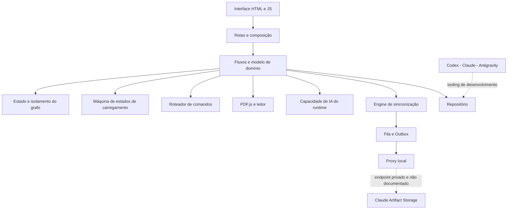

# 04 — Arquitetura técnica

> Visão de componentes e fronteiras. Experimentos com APIs privadas não são contratos públicos nem garantias de integração.

## Fronteiras e cautelas

- Interface, rotas, domínio e integrações são responsabilidades distintas.
- Grafo, carregamento, comandos e PDF.js não devem virar um módulo genérico único.
- O relatório de Storage registra endpoint privado e não documentado; compatibilidade pode mudar sem aviso.
- A Browser Bridge foi considerada bloqueada por CSP/sandbox; não a descreva como integração funcional.
- Infraestrutura de agentes é tooling de desenvolvimento, não dependência do runtime do usuário.

## Documentos

- [Claude Pro Storage API](../../reports/claude-storage-api/CLAUDE_STORAGE_API_INTEGRATION.md)
- [Investigação Storage Bridge](../../reports/claude-storage-bridge/CLAUDE_STORAGE_BRIDGE_INVESTIGATION.md)
- [Fontes de verdade do board](../FONTES.md)

## Blocos originais

- [e410 — Camada de IA](../../../prototypes/board-exam-app/index.html#e410)
- [e1248 — Infraestrutura de agentes](../../../prototypes/board-exam-app/index.html#e1248)
- [e1371 — Storage Bridge PoC](../../../prototypes/board-exam-app/index.html#e1371)
- [e1440 — Storage homologado](../../../prototypes/board-exam-app/index.html#e1440)
- [e1407 — Isolamento do grafo](../../../prototypes/board-exam-app/index.html#e1407)
- [e1450 — Máquina de estados de carregamento](../../../prototypes/board-exam-app/index.html#e1450)
