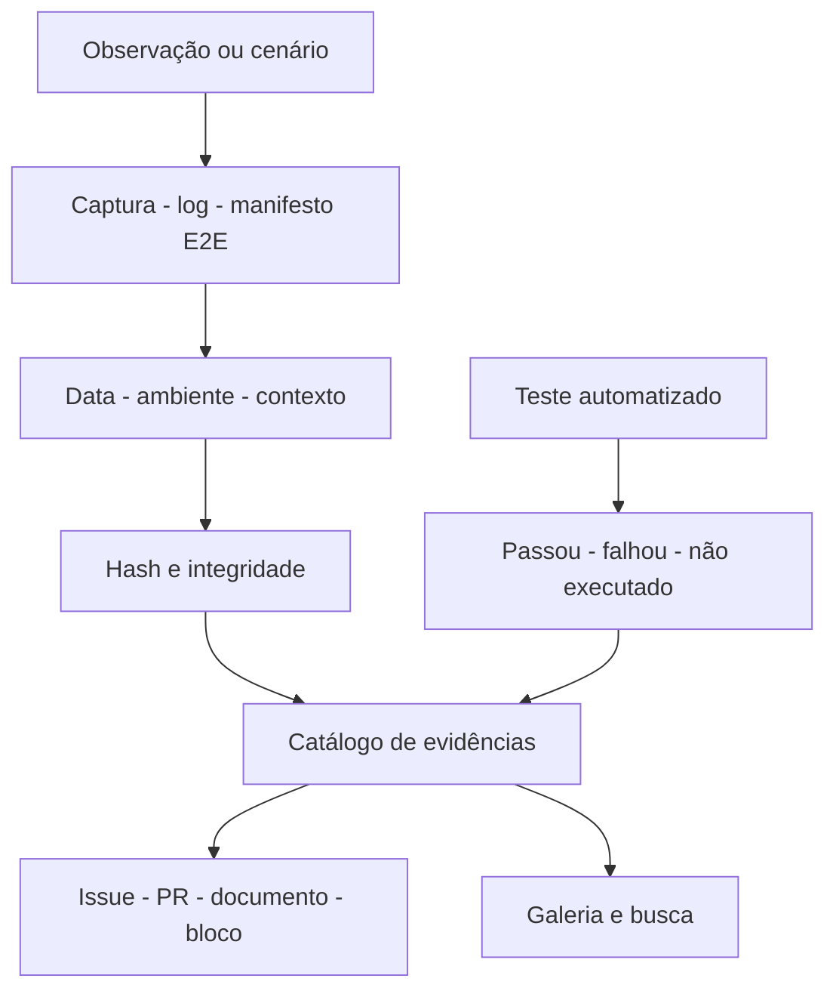

# 06 — Evidências e qualidade

> Evidência informa o que foi observado, em qual ambiente e por qual método. Status textual não substitui teste, captura ou CI.

## Contrato mínimo

- Registre arquivo, hash, data, ambiente, funcionalidade e finalidade.
- Diferencie benchmark, captura do protótipo, inspeção técnica e teste executado.
- Vincule evidência a issue/PR/documento/bloco apenas quando comprovado.
- Duplicata não é evidência canônica adicional; órfão precisa de contexto.
- Resultado deve informar cenário, ambiente, comando e limites da conclusão.

## Documentos

- [Catálogo Markdown](../../evidence/CATALOG.md)
- [Catálogo JSON](../../evidence/catalog.json)
- [Galeria](../../evidence/gallery.html)
- [Relatório da reestruturação](../RELATORIO-REESTRUTURACAO.md)
- [Manifesto Low-Chrome #97](../../../prototypes/board-exam-app/lowchrome_97_manifest.json)

## Manifestos E2E

- [Issue #68 — Exportação do grafo](../../../prototypes/board-exam-app/issue68_export_e2e.json)
- [Issue #70 — Filtros avançados](../../../prototypes/board-exam-app/issue70_e2e.json)
- [Issue #75 — Cadernos e filtros](../../../prototypes/board-exam-app/issue75_e2e.json)
- [Issue #76 — Recuperação](../../../prototypes/board-exam-app/issue76_recovery_e2e.json)
- [Issue #77 — PDF Reader](../../../prototypes/board-exam-app/issue77_reader_e2e.json)
- [Issue #82 — Revisão diária](../../../prototypes/board-exam-app/issue82_daily_review_e2e.json)
- [Issue #120 — Tema e seletores](../../../prototypes/board-exam-app/issue120_e2e.json)
- [Issue #128 — Movimento do grafo](../../../prototypes/board-exam-app/issue128_motion_e2e.json)
- [Issue #132 — Responsividade Home](../../../prototypes/board-exam-app/issue132_home_e2e.json)
- [Issue #136 — Questões contextuais](../../../prototypes/board-exam-app/issue136_e2e.json)
- [Issue #138 — SpaceSwitcher](../../../prototypes/board-exam-app/issue138_spaces_e2e.json)
- [Issue #139 — Comandos](../../../prototypes/board-exam-app/issue139_commands_e2e.json)
- [Issue #140 — Type Studio](../../../prototypes/board-exam-app/issue140_type_studio_e2e.json)
- [Diagnóstico PDF #112](../../../prototypes/board-exam-app/pdf112_diagnostic.json)

## Blocos originais

- [e300 — Prints e feedback](../../../prototypes/board-exam-app/index.html#e300)
- [e993 — Low-Chrome](../../../prototypes/board-exam-app/index.html#e993)
- [e1300 — Gaps de referência](../../../prototypes/board-exam-app/index.html#e1300)
