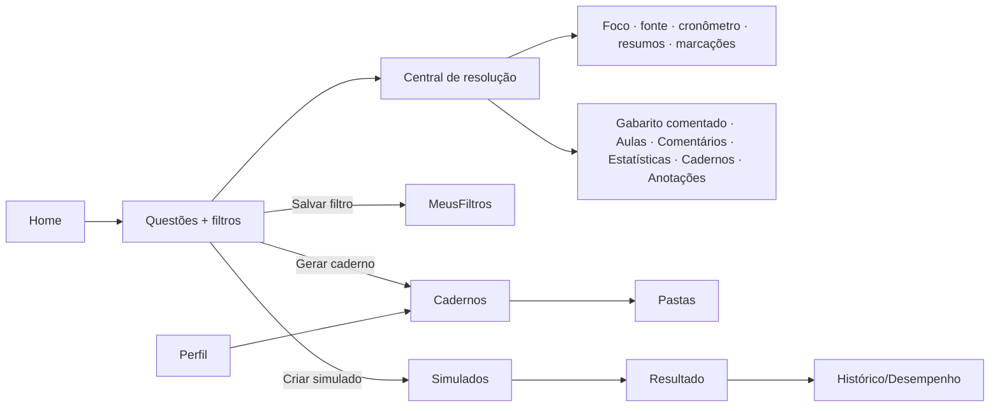
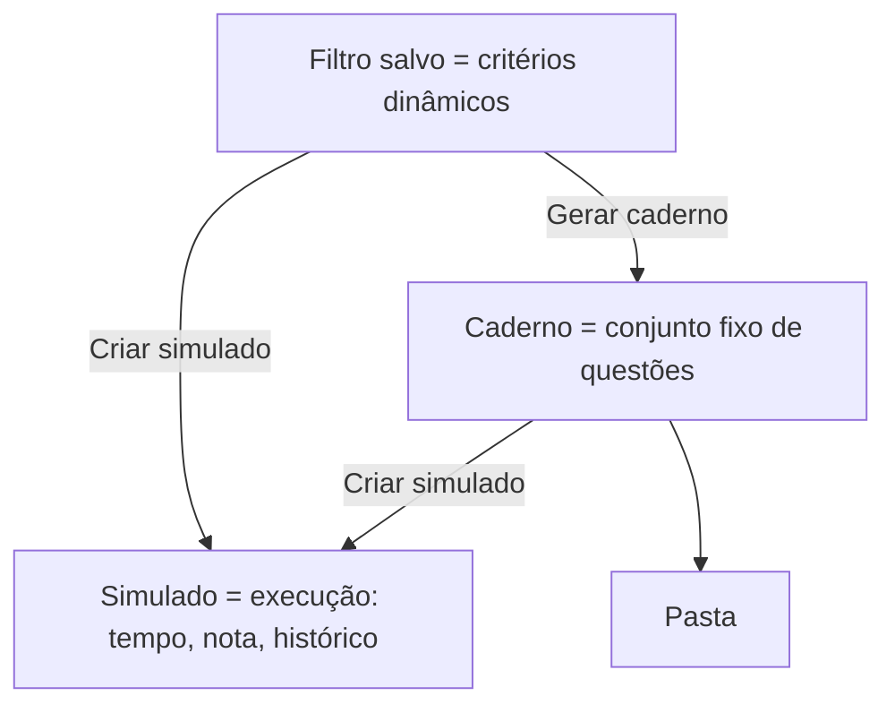

# Inventário QConcursos — referência de produto para o Exam App

*Issue #31 · coleta de 14/11/2026 · documento versionado em `prototype/inventario-qconcursos.md`.*

## 0. Como ler este documento (limites da coleta)

Esta sessão **não conseguiu abrir** `qconcursos.com`, `suporte.qconcursos.com` nem `elite.qconcursos.com`: o proxy de saída do ambiente recusou a conexão (HTTP 403 no túnel, testado em 14/11/2026). Logo **nenhuma afirmação abaixo é observação direta feita agora**. As fontes são:

- **[R-int]** análise interna de 13/11/2026 (`analise-qconcursos.md`) e `referencias/qconcursos.md` (12/11/2026), que citam páginas de suporte oficiais;
- **[R-issue]** comentários do próprio Ian na issue #31 (13–14/11/2026), que citam artigos de suporte e uma sessão ao vivo no QConcursos Elite (screenshots em `prototypes/board-exam-app/assets/qconcursos_live_*.png`);
- **[Web]** resultados de busca de 14/11/2026 (apenas títulos/URLs, sem leitura do conteúdo);
- **[Código]** leitura do `dev` (`prototypes/exam-app-0.1.1/index.html`).

Rótulos de confiança: **Confirmado** (documentação oficial citada por duas fontes internas), **Relatado** (uma fonte interna/externa, não reverificada), **Inferido**, **Não verificado**, **Contraditório**. Nada aqui afirma código, banco ou infraestrutura privados do QConcursos.

## 1. Produtos e posicionamento

| Item | Situação | Fonte |
|---|---|---|
| Portal de questões de concursos com central de preparação, cadernos, filtros, simulados, aulas, comentários e estatísticas | Confirmado | [R-int], [R-issue] |
| Simulado personalizado, simulados baseados em provas anteriores e "simuladão" semanal | Confirmado | [R-int] (suporte) |
| Aplicativo móvel com modo offline | Confirmado | [artigo de suporte](https://suporte.qconcursos.com/pt-BR/articles/11654746-como-ativar-o-modo-offline-no-aplicativo-do-qconcursos) via [R-issue]; [App Store](https://apps.apple.com/app/id1470271696) apareceu na busca [Web] |
| Linha de cursos/trilhas ("Elite", "estude.qconcursos.com") | Relatado | [R-issue], [Web] (PDFs de simulados hospedados em estude.qconcursos.com) |
| Segmentos atendidos (OAB, ENEM, militares, vestibulares) | Relatado | [R-int]; **não verificado** em fonte atual |
| Preços, limites por plano, cancelamento | **Não verificado** | nenhuma fonte atual lida |
| Perfis públicos de usuário mostram "quantidade total de cadernos" | Relatado | [Web] (ex.: páginas `qconcursos.com/usuario/perfil/...`); indica cadernos como item social/contável |

## 2. Arquitetura de informação (o que se sabe)

Seções funcionais: Questões (filtro + resolução), Cadernos (e pastas), Filtros salvos ("Meus filtros"), Simulados, Desempenho/Estatísticas, Cursos/Aulas, Perfil. Rotas reais citadas: `/usuario/perfil/<usuario>` e o guia `/questoes-de-concursos/guias/organize-seus-estudos` [R-issue]. **Sitemap completo, slugs, query strings, paginação, 404/paywall: não verificado.**

## 3. Filtros e busca

**Confirmado [R-int]:** filtro cumulativo entre categorias; "Anuladas" e "Desatualizadas" excluídas por padrão; ações **Filtrar**, **Limpar**, **Aplicar último filtro**; após filtrar surgem **Salvar filtro**, **Gerar caderno**, **Meus cadernos**, **Meus filtros**, **Criar simulado**. Simulado personalizado aceita 1–12 disciplinas; avisos de quebra ao passar de limites por categoria (ex.: 63 disciplinas, 51 bancas). Erro ao salvar filtro por limite de itens tem [artigo próprio](https://suporte.qconcursos.com/pt-BR/articles/11655254-erro-ao-salvar-o-filtro-entenda-o-motivo) [R-issue].

| Categoria | Observação | Confiança |
|---|---|---|
| Disciplina → Assunto (cascata) | selects em cascata | Relatado (Elite, [R-issue] #70) |
| Banca, ano, órgão, cargo, nível, formação, atuação, leis, modalidade, dificuldade | critérios de filtragem documentados | Confirmado [R-int] |
| Resolvidas, Não resolvidas, Acertei, Errei | estado do usuário | Confirmado |
| Anuladas, Desatualizadas, "Dos meus cadernos" | caixas de exclusão | Confirmado / Relatado (Elite) |
| Comentadas, com aulas, minhas anotações | características da questão | Relatado |
| Chips "Filtrar por:" | filtros ativos | Relatado (Elite) |
| Semântica AND entre grupos / OR dentro do grupo | AND entre grupos confirmado; OR dentro de grupo **não verificado** (a análise interna diz que alguns filtros aceitam um valor só) | Contraditório/Não verificado |
| Ordenação, tamanho de página, busca por código, contagem por opção | **Não verificado** | — |

## 4. Resolução de questão

[Central de resolução](https://suporte.qconcursos.com/pt-BR/articles/11649035-como-resolver-questoes-na-central-de-preparacao) [R-issue]: após responder aparecem gabarito comentado, aulas, comentários, estatísticas, cadernos e anotações. Ferramentas laterais: foco, desempenho, tamanho da fonte, cronômetro, resumos, marcações. Relatado na sessão Elite [R-issue]: cabeçalho compacto (código + breadcrumb; ano · banca · órgão · prova), toggle de texto associado, **riscar alternativas**, confirmação em duas etapas (selecionar → Responder), abas pedagógicas (estatísticas com donut e distribuição A–E), marca-texto no enunciado, folha de respostas. Pós-resposta: feedback imediato é o comportamento documentado; **feedback adiado, alteração de resposta e reset: não verificados**.

## 5. Cadernos, filtros salvos, simulados

- Caderno guarda questões, filtro guarda critérios (Confirmado [R-int]); se o caderno é snapshot puro ou atualiza, **não verificado**.
- Caderno do curso: lotes de até 30 questões; remover chip "Caderno" mantém demais filtros (doc de 13/10/2026, [artigo](https://suporte.qconcursos.com/pt-BR/articles/17589060-como-usar-o-caderno-de-questoes-do-curso)); **não generalizar**.
- Offline: Filtros → filtro salvo → ⋯ → Baixar questões, até 1000 por download; desempenho contabilizado após reconexão [R-issue]. Política de merge/conflito: **não verificado**.
- Elite (relatado): progresso `X/N`, "Continuar de onde parou", "Refazer erradas", Caderno de Erros automático (questão só recuperada ao acertar de novo), Raio-X da banca/edital verticalizado.
- Simulado: quantidade, tempo, disciplinas; histórico de resultados sustenta separar simulado × tentativa (Inferido).

## 6. Modelo de domínio (conceitual)

Ver ER completo em `referencias/qconcursos.md` (marcado [D]/[P]/[C]). Resumo das regras que importam: questão reutilizável; alternativa não obrigatória; gabarito separado da resposta; estado da questão (anulada, desatualizada) ≠ estado do usuário (resolvida, acertou); filtro guarda critérios; estatística é cálculo. **Todas as cardinalidades são proposta**, não publicadas pelo QConcursos.

## 7. UI/UX, acessibilidade, técnica

Único artefato visual: [imagem de simulados](https://odin.qconcursos.com/packs/assets/v2-jornada-revisao-32bd60d3c1f7e8298799.jpg) de marketing, **data da UI não verificada**; o domínio `odin.qconcursos.com/packs/assets` sugere empacotamento Webpacker/Rails (Inferido, fraco). Cores, tipografia, breakpoints, componentes, acessibilidade por teclado/leitor de tela, SEO e structured data: **Não verificado**. Existem 18 screenshots da sessão Elite no repo (não reanalisados aqui).

## 8. Reputação e comunidade

Busca em 14/11/2026 por "QConcursos Reclame Aqui" devolveu uma reclamação ligada à marca ([demora no atendimento, marcada "resolvida"](https://www.reclameaqui.com.br/qconcursos/demora-absurda-no-atendimento_H2fOK-KrzT7_mIct/)); o resto dos resultados era de **outras empresas** (Projeto Caveira, Aprovação Ágil, Direção Concursos etc.) e **não deve ser atribuído ao QConcursos**. Reddit/fóruns/Trustpilot/app stores: **não verificado** (conteúdo não lido). Reclamações recorrentes do setor (cancelamento de planos anuais, suporte lento) são padrão de mercado, não evidência sobre o QConcursos. Qualidade de gabaritos, anulações, autoria de comentários: **não verificado**.

## 9. Matriz QConcursos × ExamTopics × Exam App (`dev`)

| Recurso | QConcursos | ExamTopics ([#28]/análise) | Exam App `dev` [Código] |
|---|---|---|---|
| Filtro multi-categoria com chips | Sim (E entre categorias) | Poucos filtros | `qfHTML()` com Filtrar, chips "Filtrar por:", multisseleção, "Mais filtros", busca de texto, atalhos de situação; compartilhado entre listas (`key`) |
| Situação do usuário | 4 estados | parcial | atalhos `sit` no `qfHTML` |
| Exclusões (anuladas…) | padrão ligado | não | flag `x.anuladas` presente; demais dependem de dado |
| Filtro salvo | Meus filtros | não | "Salvar filtro" → Meus filtros (`#/questoes`, Queries/Meus filtros em Questão) |
| Caderno | Sim + pastas | não | "Gerar Caderno", páginas de caderno (progresso, refazer incorretas) |
| Simulado a partir do filtro | Sim | não | "Fazer simulado (N)" na página Questão; `#/simulado` configurável |
| Desempenho | Estatísticas | limitado | `perfSec`, resultado por disciplina |
| Offline | app móvel | não | não existe |
| Comentários/comunidade | Sim | Sim (discussão) | fora de escopo (decisão do Ian) |
| Estado na URL | não verificado | sim | `qfSyncURL()` só para `study` |

*A análise interna de 13/11 (antes de várias mudanças) dizia que ordenação, filtros salvos e cadernos não existiam; o `dev` atual já tem Salvar filtro, Gerar Caderno e Meus cadernos. Ordenação e paginação unificada precisam ser reconferidas no app antes de abrir issues.*

## 10. Recomendações priorizadas

1. **Alta:** consolidar todas as listas no componente único (`qfHTML`) com URL, ordenação e paginação; busca por código.
2. **Alta:** sinalizar visualmente "total global × filtrado" e contagem por opção.
3. **Média:** Visão (filtro salvo) como objeto com página/sidebar; Coleção ↔ caderno com regra "guarda questões, não critérios".
4. **Média:** pós-resposta enxuto (gabarito, estatísticas, caderno, anotação) e riscar alternativa; ferramentas de estudo (fonte, foco, cronômetro).
5. **Baixa/adiar:** offline, pastas, comentários comunitários, "desatualizadas", filtros de escolaridade/formação sem dado.
Critério de aceite geral: cada recurso só aparece quando houver dado real (2+ valores), e cada valor de propriedade é link para a própria página.

## 11. Lacunas abertas (obrigatório pela issue)

Acesso direto ao site/suporte/Elite bloqueado nesta sessão. **Pendente (Não verificado):** sitemap e URLs reais; estados 404/paywall/vazio; ordenação, paginação e busca por código; OR dentro de categoria; snapshot × dinâmico dos cadernos; política de anulação sobre tentativas antigas; planos, preços e limites; acessibilidade; screenshots atuais desktop/mobile; leitura real de Reddit, Reclame Aqui, app stores; comparação com TEC e Gran Questões. Recomenda-se uma sessão de pesquisa em dispositivo com acesso (Remote Control em `ian-pc` com navegador) para fechar essas lacunas.
