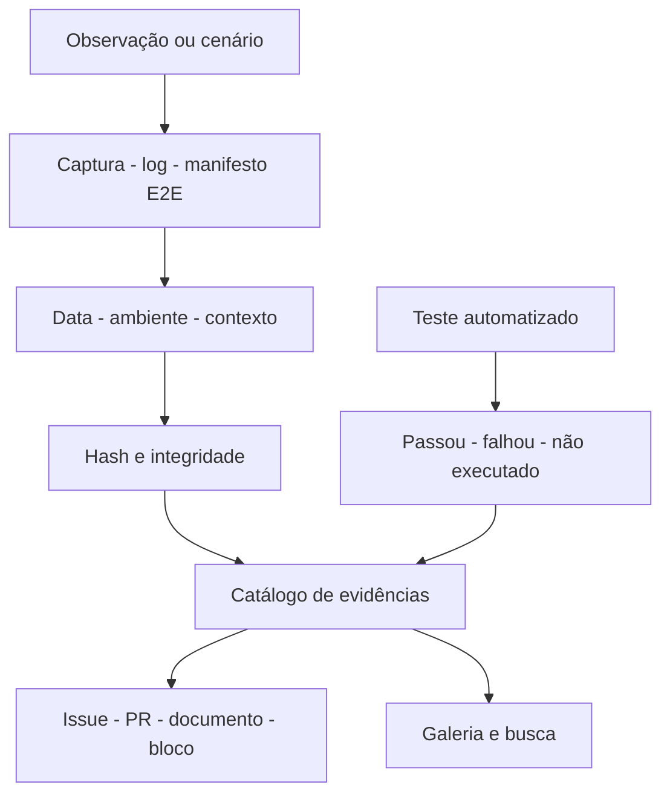

# 06 — Evidências e qualidade

> Evidência informa o que foi observado, em qual ambiente e por qual método. Status textual não substitui teste, captura ou CI.

## Contrato mínimo

- Registre arquivo, hash, data, ambiente, funcionalidade e finalidade.
- Diferencie benchmark, captura do protótipo, inspeção técnica e teste executado.
- Vincule evidência a issue/PR/documento/bloco apenas quando comprovado.
- Duplicata não é evidência canônica adicional; órfão precisa de contexto.
- Resultado deve informar cenário, ambiente, comando e limites da conclusão.

## Documentos

- [Catálogo Markdown](CATALOG.md)
- [Catálogo JSON](catalog.json)
- [Galeria](gallery.html)
- [Relatório da reestruturação](RELATORIO-REESTRUTURACAO.md)
- [Manifesto Low-Chrome #97](lowchrome_97_manifest.json)

## Manifestos E2E

- [Issue #68 — Exportação do grafo](issue68_export_e2e.json)
- [Issue #70 — Filtros avançados](issue70_e2e.json)
- [Issue #75 — Cadernos e filtros](issue75_e2e.json)
- [Issue #76 — Recuperação](issue76_recovery_e2e.json)
- [Issue #77 — PDF Reader](issue77_reader_e2e.json)
- [Issue #82 — Revisão diária](issue82_daily_review_e2e.json)
- [Issue #120 — Tema e seletores](issue120_e2e.json)
- [Issue #128 — Movimento do grafo](issue128_motion_e2e.json)
- [Issue #132 — Responsividade Home](issue132_home_e2e.json)
- [Issue #136 — Questões contextuais](issue136_e2e.json)
- [Issue #138 — SpaceSwitcher](issue138_spaces_e2e.json)
- [Issue #139 — Comandos](issue139_commands_e2e.json)
- [Issue #140 — Type Studio](issue140_type_studio_e2e.json)
- [Diagnóstico PDF #112](pdf112_diagnostic.json)

## Blocos originais

- [e300 — Prints e feedback](board-exam-app__index.html#e300)
- [e993 — Low-Chrome](board-exam-app__index.html#e993)
- [e1300 — Gaps de referência](board-exam-app__index.html#e1300)
