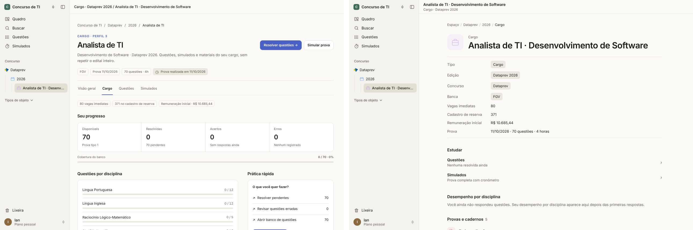
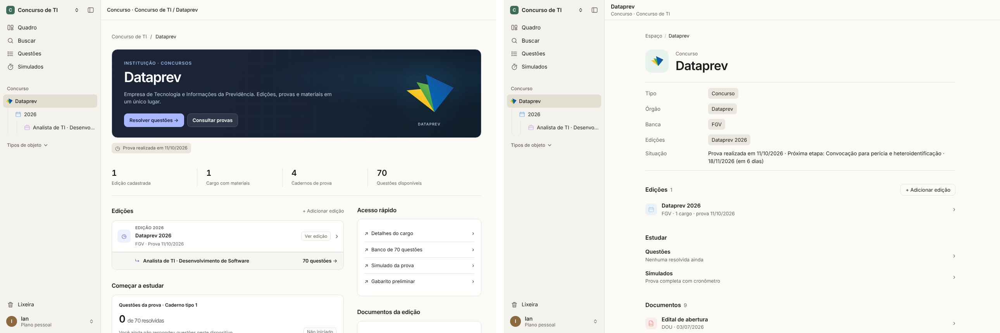
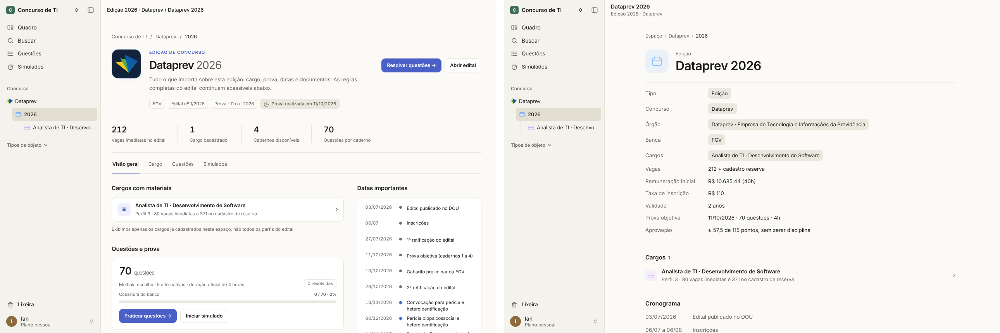
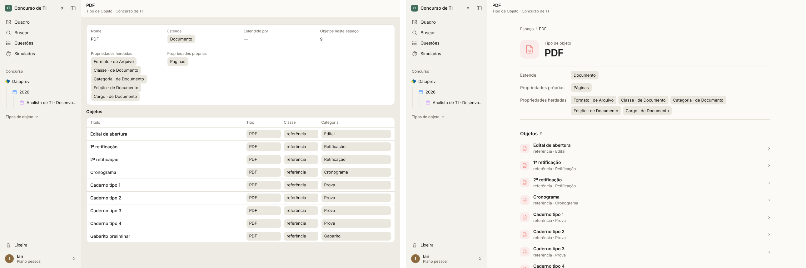

# Board Mestre — índice do Exam App

> Índice compacto. Não contém conteúdo: aponta para blocos existentes do board.json por ID estável. Não mover nem apagar blocos do canvas; para adicionar um bloco, inclua aqui o ID dele.

## 01 — Discovery & Research

Concorrentes, referências e pesquisas que motivaram o produto.

| Card | Estado | Blocos |
| --- | --- | --- |
| Referências QConcursos | pesquisa | `e108` |
| Referências ExamTopics | pesquisa | `e116` |
| Referências Readwise | pesquisa | `e119` |
| Dossiê QConcursos (funcional) | pesquisa | `e900` |
| Dossiê Readwise Reader e SRS | pesquisa | `e1090` |
| Matriz de decisões extraída dos sites | decisão | `e1150` |
| Auditoria UI/UX | pesquisa | `e600` |

## 02 — Product & UX

Funcionalidades por jornada do usuário, layout e diretrizes.

| Card | Estado | Blocos |
| --- | --- | --- |
| Layout de três painéis | implementado | `e500` |
| Estrutura Espaço → Objeto → Tipo | implementado | `e52` |
| Diretrizes de UI/UX | implementado | `e162` |
| Questões e simulados | implementado | `e1155` |
| Cadernos e queries de questões | implementado | `e1188` |
| Filtros avançados | implementado | `e1208` |
| Painel de propriedades | proposto | `e504` |
| Dashboard central de estudos | proposto | `e506` |
| Revisão diária | implementado | `e1465` |
| Leitor PDF e anotações | implementado | `e1477`, `e1177` |
| Responsividade da home | implementado | `e1339` |

## 03 — Software Architecture

Modelo de domínio, tipos, decisões técnicas e estado.

| Card | Estado | Blocos |
| --- | --- | --- |
| Hierarquia de tipos | implementado | `e99`, `e104` |
| Glossário das entidades | implementado | `e95` |
| Decisões de modelagem | aprovado | `e152` |
| Camada de IA | implementado | `e410` |
| Isolamento de grafo por espaço | validado | `e1407` |
| Máquina de estados de carregamento | implementado | `e1450` |
| Storage bridge (prova de conceito) | proposto | `e1371` |

## 04 — Delivery & Roadmap

Versões, roadmap e issues entregues.

| Card | Estado | Blocos |
| --- | --- | --- |
| Roadmap de versões | aprovado | `e154` |
| Versão 0.1.0 | substituído | `e4` |
| Versão 0.1.1 | em desenvolvimento | `e149` |
| Infraestrutura de agentes | implementado | `e1248` |

## 05 — Evidence & Quality

Prints, arquivos, testes e homologações. Cada card indica o que foi realmente verificado.

| Card | Estado | Blocos |
| --- | --- | --- |
| Antes/depois: páginas de objeto (Cargo, Concurso, Edição, Tipo PDF) | evidência |     |
| Prints do Ian e feedback | evidência | `e300` |
| Arquivos do projeto | evidência | `e363` |
| Evidências do low-chrome (#97) | validado | `e993` |
| Evidências dos 7 gaps | evidência | `e1300` |
| Homologação final | validado | `e1440` |
